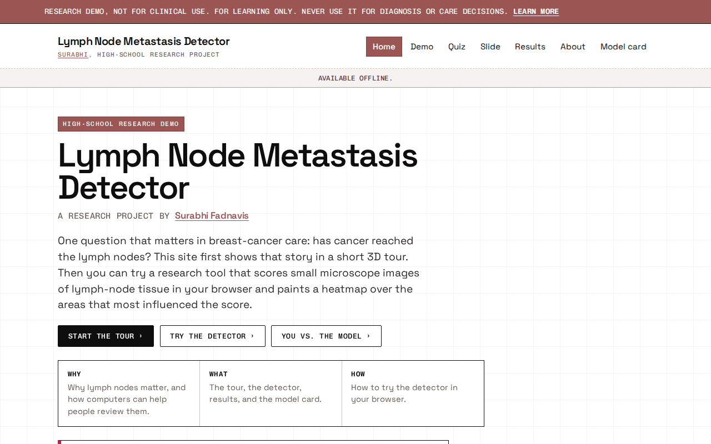
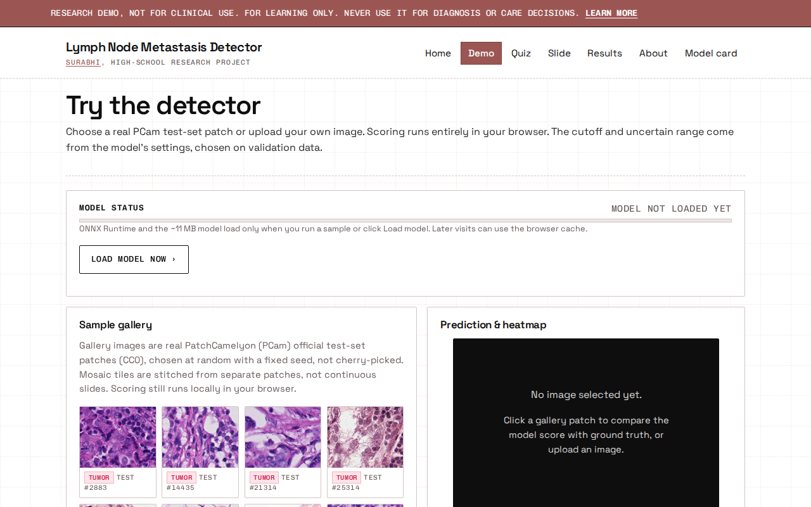
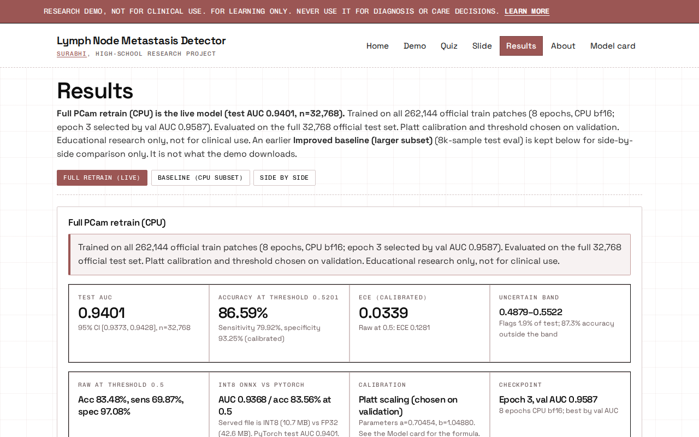

# Lymph Node Metastasis Detector

**Research demo — not for clinical use.**

**Live demo:** [https://surabhif.github.io/Lymph-node-metastasis-detector/](https://surabhif.github.io/Lymph-node-metastasis-detector/)

A high-school research project by **Surabhi Fadnavis**: a ResNet-18 trained on [PatchCamelyon (PCam)](https://github.com/basveeling/pcam) that scores whether a 96×96 lymph-node histology patch shows metastatic tumor. The model runs **in the browser** (ONNX Runtime Web) and shows a class-activation heatmap. Educational study of a public dataset — not a diagnostic tool.

[](https://colab.research.google.com/github/surabhif/Lymph-node-metastasis-detector/blob/main/notebooks/01_train_pcam.ipynb)

<p>
  
  &nbsp;
  
  &nbsp;
  
</p>

## Headline metrics (live model `full_pcam_int8_v1`)

ResNet-18 trained on **all 262,144** official PCam train patches; evaluated on the full official **test** set (**n = 32,768**). Numbers below are from the PyTorch checkpoint (source of truth on Results / Model card). The browser serves a dynamic **INT8** ONNX export of the same model (~10.7 MB).

| Metric | Value |
|--------|------:|
| Test AUC | **0.9401** (95% CI 0.9373–0.9428) |
| Accuracy @ threshold 0.5201 | **86.59%** |
| Sensitivity | 79.92% |
| Specificity | 93.25% |
| ECE (calibrated) | 0.0339 |
| Decision threshold (Youden on val) | 0.5201 |
| Uncertain band | 0.4879–0.5522 |
| Platt calibration | a = 0.70454, b = 1.04880 |

**About INT8 vs PyTorch:** Quantization shrinks the download. On the same test split, the INT8 file scores raw AUC **0.9368** and accuracy **83.56% at threshold 0.5** (before Platt calibration and before the chosen 0.5201 cutoff). That is a small drop from PyTorch AUC 0.9401 — both are reported honestly. Demo scores use Platt calibration on the INT8 probability.

## Site features

- **Landing** — Why lymph nodes matter, what the demo does, and how to try it
- **3D explainer** — Scroll-driven anatomy view of metastasis in a lymph node (HRA meshes)
- **Demo** — Score gallery patches (or your own image) with a CAM heatmap
- **Quiz** — “You vs. the model” on held-out test patches
- **Slide viewer** — Pan/zoom a region stitched from PCam patches with a heatmap overlay
- **Results** — Full-test metrics, reliability charts, confusion matrix, stain-colour checks
- **Model card** — Intended use, limits, and the same metrics as Results
- **About** — Project story, ethics, how to cite
- **Project-family footer** — Links to related student projects

Direct links (refresh-safe on GitHub Pages): [`/`](https://surabhif.github.io/Lymph-node-metastasis-detector/), [`/demo/`](https://surabhif.github.io/Lymph-node-metastasis-detector/demo/), [`/quiz/`](https://surabhif.github.io/Lymph-node-metastasis-detector/quiz/), [`/slide/`](https://surabhif.github.io/Lymph-node-metastasis-detector/slide/), [`/results/`](https://surabhif.github.io/Lymph-node-metastasis-detector/results/), [`/model-card/`](https://surabhif.github.io/Lymph-node-metastasis-detector/model-card/), [`/about/`](https://surabhif.github.io/Lymph-node-metastasis-detector/about/).

## Project description

Lymph-node status matters for breast-cancer surgery planning. This project studies a **public** patch dataset (PCam / Camelyon16 lineage) end to end: train a small CNN, evaluate it on the official test split, calibrate scores, export ONNX, and ship a browser demo with heatmaps.

The live weights are the **full-PCam retrain** (`full_pcam_int8_v1`). An earlier subset baseline remains on Results for side-by-side comparison only; it is not what the browser downloads.

Training and evaluation scripts live in `training/`. A guided Colab notebook in `notebooks/` walks through the same ideas on a smaller subset. Colour / stain-shift checks are documented in `results/stain_robustness.md` (re-run on the live INT8 model).

## What’s in this repo

| Path | Purpose |
|------|---------|
| `notebooks/01_train_pcam.ipynb` | Guided Colab teaching notebook |
| `training/` | Full-run train / evaluate scripts used for the live model |
| `web/` | React + Vite research site |
| `web/public/models/pcam_cam.onnx` | Live INT8 ONNX (~10.7 MB) |
| `web/public/results/full_retrain_metrics.json` | Full official-split test metrics |
| `results/stain_robustness.md` | Stain / colour robustness write-up |
| `results/quantization_report.json` | FP32→INT8 size and gallery score deltas |
| `web/public/samples/` | Real PCam test-set gallery patches (CC0) |
| `scripts/` | Gallery export, quantization, stain checks, helpers |
| `.github/workflows/deploy-pages.yml` | Build & deploy to GitHub Pages on `main` |

## Third-party anatomy assets

The landing explainer uses **NIH/HuBMAP Human Reference Atlas** female skin, right mammary gland, and lymph-node meshes (**CC BY 4.0**), plus BodyParts3D chest cues (**CC BY 4.0**) under the skin. See [`CREDITS.md`](./CREDITS.md) and [`THIRD_PARTY_NOTICES.md`](./THIRD_PARTY_NOTICES.md). Application code remains MIT; the meshes stay under CC BY 4.0.

## Train in Colab

1. Open the notebook with the badge above (or upload `notebooks/01_train_pcam.ipynb`).
2. Runtime → GPU (T4 is fine).
3. Start with a small subset and few epochs so a first pass finishes quickly; raise them for a serious run.
4. Keep PCam’s **official train / val / test splits** — never reshuffle across splits.
5. Run the ONNX export cell; download `export/pcam_cam.onnx`.

The **live demo model** came from the full official-split run in `training/` (not from a quick notebook subset). The notebook is for learning and smaller experiments.

### Drop in a trained model

```text
web/public/models/pcam_cam.onnx   ← replace with your export
```

Then update `web/src/lib/constants.ts` (`MODEL_STATUS`), `web/public/models/model_manifest.json`, and regenerate quiz scores with `python scripts/export_quiz.py` if needed.

## ONNX contract (notebook ↔ web app)

- **Input** `input`: `float32[N,3,96,96]` ImageNet-normalized RGB  
- **Output** `probability`: `float32[N,1]` P(tumor / metastasis)  
- **Output** `features`: `float32[N,C,H,W]` final conv feature maps  
- **Output** `cam_weights`: `float32[C]` weights for browser CAM  

Browser CAM (no gradients): `CAM = ReLU(Σ_c w_c · F_c)`, normalized, upsampled, overlaid.  
Images larger than ~96×96 are scanned patch-by-patch into a probability map.

## Citations & licenses

- Veeling, B. S., et al. (2018). Rotation equivariant CNNs for digital pathology. *MICCAI*. PCam (CC0): https://github.com/basveeling/pcam  
- Ehteshami Bejnordi, B., et al. (2017). Diagnostic assessment of deep learning algorithms for detection of lymph node metastases… *JAMA* (Camelyon16).  
- This repository’s code: **MIT** (see `LICENSE`).

## Credits and help

- **Surabhi** owns training, experiments, evaluation, figures, the Results/model-card write-up, and every scientific design choice she can explain.
- The **web app scaffold**, **GitHub Pages workflow**, **placeholder model/samples**, and **teaching-notebook template** were built with help from **Cursor AI** so she could focus on learning and running the ML. That help should stay disclosed in applications and mentor letters.

## Ethics (short)

Public de-identified data only. No clinic PHI. No clinical use. Don’t overclaim metrics. Prefer an honest unfinished Results page over invented numbers.

## Developer setup

```bash
cd web
npm install
npm run dev
```

Open the printed localhost URL. Use **Demo** / `/demo` — gallery samples should show differentiated scores and a heatmap.

Build with the GitHub Pages base path:

```bash
cd web
VITE_BASE=/Lymph-node-metastasis-detector/ npm run build
npm run preview
# optional ORT smoke test:
npm run smoke-ort
```

Pushing to `main` runs `.github/workflows/deploy-pages.yml`, which builds `web/` with `VITE_BASE=/Lymph-node-metastasis-detector/` and deploys `web/dist`. After the Vite build, `web/scripts/spa-gh-pages-fallback.mjs` writes `404.html` and per-route `index.html` files for `results`, `about`, `demo`, `model-card`, `quiz`, and `slide` so refresh / shared deep links return the app shell.

**One-time GitHub Pages settings (repo admin):**

1. Repo → **Settings** → **Pages**
2. Under “Build and deployment”, set **Source** to **GitHub Actions**
3. After the first green workflow on `main`, the site is at  
   `https://surabhif.github.io/Lymph-node-metastasis-detector/`

Useful scripts:

```bash
python scripts/run_stain_robustness_onnx.py   # colour / stain-shift check on live ONNX
python scripts/export_web_results.py          # refresh baseline Results JSON (historical)
python scripts/quantize_onnx.py               # optional INT8 shrink + delta report
python scripts/export_quiz.py                 # regenerate quiz pool scores
```
