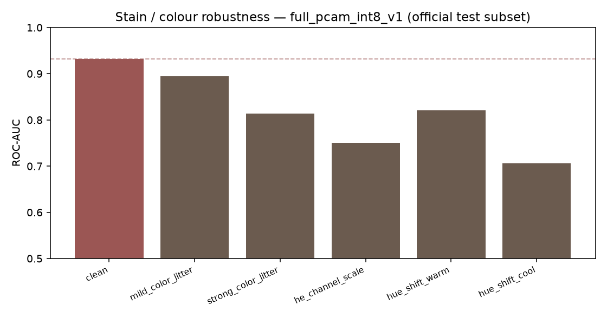
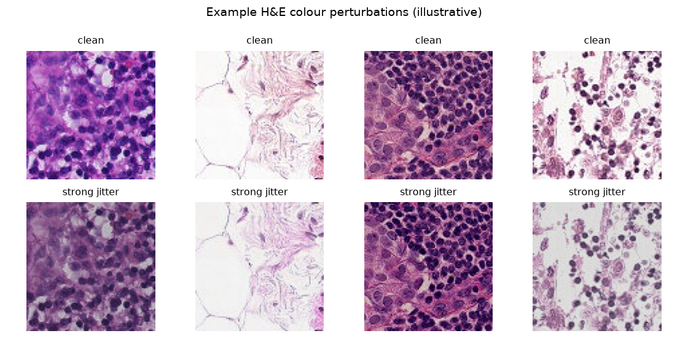

# Stain / colour robustness

> Educational research check, not a clinical validation.

## Method

Held-out fixed-seed subset of the official PCam test split. Perturbations: mild/strong ColorJitter (hue/saturation/brightness/contrast), approximate H&E RGB channel scaling, and fixed warm/cool hue shifts. Not full Macenko or Vahadane stain normalization — those were out of scope; a simpler colour jitter is used instead.

- Evaluation subset: **4000** patches from the official PCam **test** split (fixed seed `49`; within-split shuffle only).
- Model: shipped `web/public/models/pcam_cam.onnx` (`full_pcam_int8_v1`, ResNet-18 INT8).
- Decision threshold: 0.5 on raw ONNX probability.

## Settings

```json
{
  "max_eval_samples": 4000,
  "seed": 42,
  "index_seed": 49,
  "batch_size": 64,
  "decision_threshold": 0.5,
  "backbone": "resnet18",
  "onnx": "web/public/models/pcam_cam.onnx",
  "source_run_id": "full_pcam_int8_v1"
}
```

## Results

| Perturbation | Accuracy | ROC-AUC | Δ Acc vs clean | Δ AUC vs clean | Mean |ΔP| vs clean |
|---|---:|---:|---:|---:|---:|
| `clean` | 0.8373 | 0.9317 | +0.0000 | +0.0000 | 0.0000 |
| `mild_color_jitter` | 0.7935 | 0.8949 | -0.0438 | -0.0368 | 0.1008 |
| `strong_color_jitter` | 0.7195 | 0.8134 | -0.1178 | -0.1183 | 0.1897 |
| `he_channel_scale` | 0.6737 | 0.7504 | -0.1635 | -0.1813 | 0.2153 |
| `hue_shift_warm` | 0.6995 | 0.8211 | -0.1378 | -0.1106 | 0.2306 |
| `hue_shift_cool` | 0.6435 | 0.7055 | -0.1938 | -0.2262 | 0.2543 |





## What this does *not* cover

- Macenko stain normalization
- Vahadane stain separation
- scanner-specific colour profiles
- cross-lab external cohorts

## Takeaway

If AUC or accuracy drops under strong colour / H&E-ish shifts, the model is partly relying on stain appearance rather than morphology alone. Mild shifts should stay closer to clean performance.

